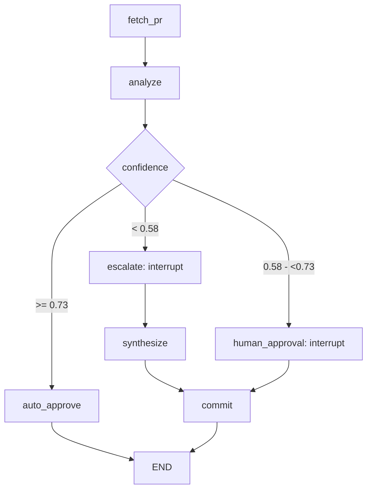

# Day27 — HITL PR Review Agent

Lời giải Lab Track 3: agent review pull request bằng LangGraph, giao diện duyệt
Streamlit và audit trail SQLite. Đã hoàn thiện bốn exercise cùng `app.py`.

## Cài đặt và chạy

Yêu cầu Python 3.11+ và uv; bản này đã kiểm thử với Python 3.12.

```powershell
uv sync --locked --python 3.12
Copy-Item .env.example .env
```

Điền `OPENROUTER_API_KEY`, `GITHUB_TOKEN`, `GITHUB_USER` trong `.env`, rồi chạy:

```powershell
uv run streamlit run app.py
```

Mở http://localhost:8501, nhập URL PR và bấm **Run review**.
Không chép đè `.env` nếu bạn đã điền key. `.env` và database được loại khỏi Git.

Token fine-grained cần chọn repo muốn review, quyền **Contents: Read** và
**Issues: Read and write** để đọc code và đăng top-level comment. Để tự tạo PR
thử, cần thêm **Contents: Read and write**, **Pull requests: Read and write**.
Token classic dùng `repo` khi repo private; tài khoản cũng phải có quyền repo.

## Các phần đã hoàn thiện

| Phần | File | Chức năng |
|---|---|---|
| Exercise 1 | `exercises/exercise_1_confidence.py` | Fetch PR, structured PRAnalysis, định tuyến confidence |
| Exercise 2 | `exercises/exercise_2_hitl.py` | MemorySaver, interrupt, approve/reject/edit, Command(resume) |
| Exercise 3 | `exercises/exercise_3_escalation.py` | Câu hỏi escalation và phân tích lại với diff, phân tích ban đầu, Q&A |
| Exercise 4 | `exercises/exercise_4_audit.py` | AsyncSqliteSaver, AuditEntry ở mỗi bước và mở lại thread |
| Exercise 5 | `app.py` | UI duyệt, form câu hỏi, recent sessions, khôi phục sau refresh |
| Replay | `audit/replay.py` | Liệt kê phiên và phát lại audit theo thời gian |

`common/` giữ nguyên các schema và helper được cung cấp. Prompt chung nằm tại
`exercises/review_prompts.py`; prompt yêu cầu nhận xét có căn cứ và phân biệt
lỗi với đề xuất. Kết quả LLM vẫn cần được kiểm tra.

## Confidence và HITL

| Confidence | Nhánh | Hành vi |
|---|---|---|
| >= 0.73 | auto_approve | Tự đăng review |
| >= 0.58 và < 0.73 | human_approval | Hiện diff, lý do, comment; chờ approve/reject/edit |
| < 0.58 | escalate | Hỏi reviewer, tổng hợp lại với câu trả lời, đăng review |

Ngưỡng import từ `common/schemas.py`. Confidence là điểm LLM tự báo cáo,
không phải xác suất đã hiệu chỉnh và không bảo đảm PR không có lỗi.

Approve đăng comment thật. Reject không đăng. Edit lưu feedback và bỏ qua đăng,
đúng yêu cầu cơ bản Exercise 2; tự viết lại khi Edit là bonus chưa triển khai.
Nhánh escalation đăng sau khi nhận câu trả lời theo hướng dẫn VLearn.



## Chạy từng exercise

Thay URL bằng PR bạn có quyền truy cập:

```powershell
uv run python exercises/exercise_1_confidence.py --pr https://github.com/vuanh259/KX-DAY27-NguyenVuAnh-2A202602502/pull/1
uv run python exercises/exercise_2_hitl.py --pr https://github.com/vuanh259/KX-DAY27-NguyenVuAnh-2A202602502/pull/1
uv run python exercises/exercise_3_escalation.py --pr https://github.com/vuanh259/KX-DAY27-NguyenVuAnh-2A202602502/pull/2
uv run python exercises/exercise_4_audit.py --pr https://github.com/vuanh259/KX-DAY27-NguyenVuAnh-2A202602502/pull/2
```

VLearn dùng `VinUni-AI20k/PR-Demo/pull/1` và `/pull/2` làm PR chuẩn.
Tài khoản hiện không truy cập được repo private này, nên kiểm thử thật sử dụng
hai draft PR tổng hợp trong repo cá nhân, theo yêu cầu của người dùng.
Các PR thử giữ ở dạng draft, không cần merge; PR #2 cố ý chứa lỗi để review,
không được dùng trong ứng dụng hoặc triển khai.

## Audit và khôi phục phiên

```powershell
uv run python -m audit.replay --list
uv run python -m audit.replay --thread <thread_id>
uv run python exercises/exercise_4_audit.py --pr <PR_URL> --thread <thread_id>
```

SQLite `hitl_audit.db` chứa cả checkpoint LangGraph lẫn bảng `audit_events` với
các cột timestamp, agent_id, action, confidence, risk_level, reviewer_id,
decision, reason, execution_time_ms. SQLite thay PostgreSQL theo hướng dẫn lab
để không cần cài database server; chưa triển khai backend PostgreSQL.

Sidebar mở lại phiên. Thread trong URL giữ phiên sau refresh. Mở lại phiên đã
hoàn tất không gọi LLM hay đăng lại. Dòng audit pending có thể lặp khi node chứa
interrupt chạy lại từ đầu, đúng cơ chế VLearn giải thích.
Checkpoint không bảo đảm GitHub posting đúng một lần nếu tiến trình chết sau
khi GitHub nhận comment nhưng trước lúc lưu kết quả node.

## Kiểm thử

```powershell
uv run python -m unittest discover -s tests -v
```

Bộ kiểm thử chạy graph và SQLite thật, giả lập GitHub/LLM, kiểm tra:

- Biên confidence 0.58/0.73 và cả ba nhánh.
- Pause/resume, approve/reject/edit và số lần gọi đăng comment.
- Escalation, ngữ cảnh refinement, reviewer và nội dung audit.
- Đóng/mở checkpointer, khôi phục phiên đã hoàn tất không đăng lại.
- Lỗi GitHub không được báo là thành công.
- Thẻ duyệt và form escalation trong Streamlit AppTest.

Kết quả chạy thật và link comment: [KIEM_THU.md](KIEM_THU.md).
Hướng dẫn tiếng Việt: [HUONG_DAN_CHAY.md](HUONG_DAN_CHAY.md).
